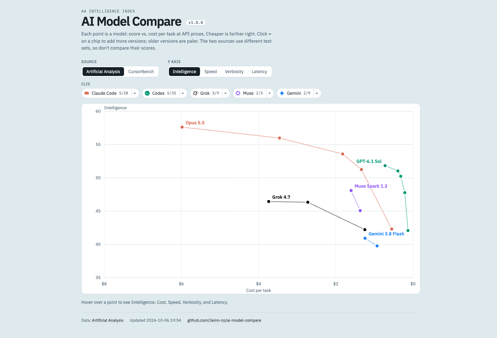
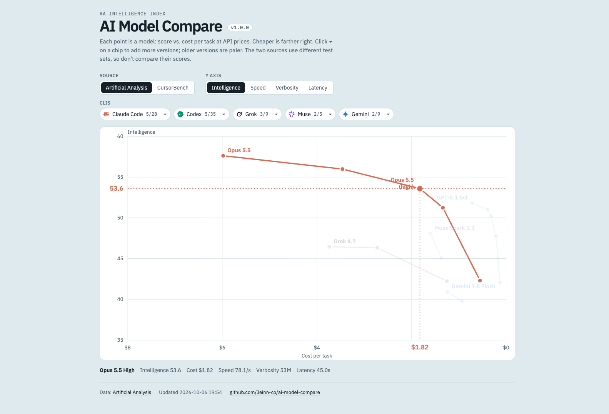
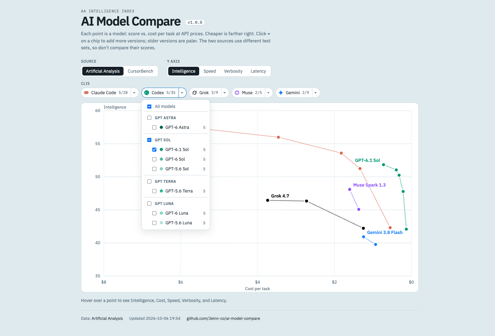
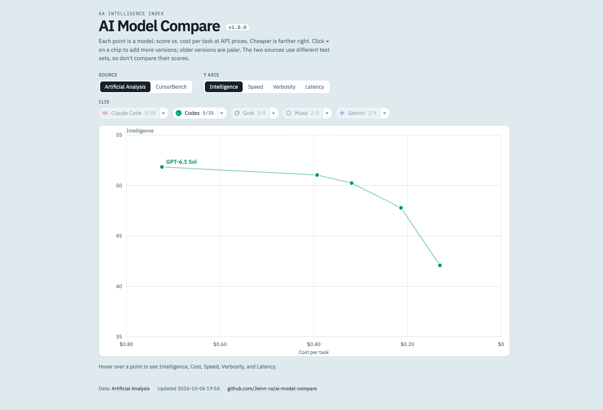
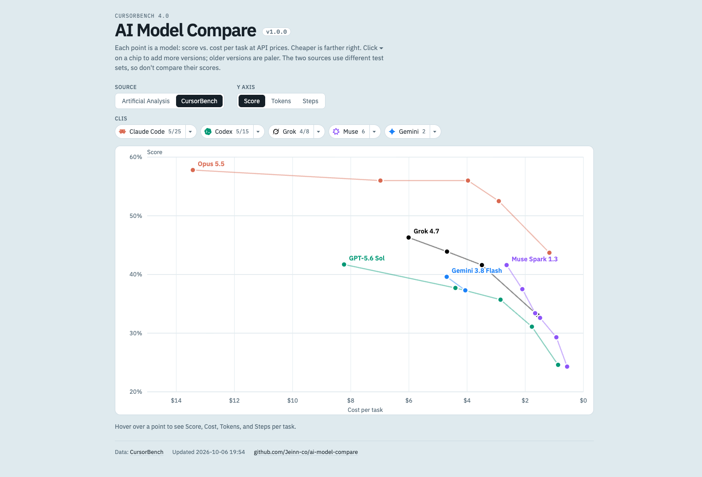

# AI Model Compare

A small chart of **score vs. cost per task** for coding AI models, from the [Artificial Analysis](https://artificialanalysis.ai/models/releases) Intelligence Index (the default), the [CursorBench](https://cursor.com/cursorbench) leaderboard, the [Terminal-Bench](https://www.tbench.ai/leaderboard) leaderboard or the [ARC-AGI-2](https://arcprize.org/leaderboard) leaderboard, so you can see at a glance which model and effort level gives the most score per dollar. Cost is per task at API prices, not a subscription. Under the chart, a ranked list shows human preference from [LMArena](https://lmarena.ai/leaderboard) (formerly Chatbot Arena).

**Live:** https://jeinn-co.github.io/ai-model-compare/ (every source checked every six hours; data published only when it changes)

| Provider    | Lines in the ▾ menu (every listed version of each)        |
| ----------- | --------------------------------------------------------- |
| Claude Code | Fable, Opus, Sonnet, Haiku                                |
| Codex       | GPT Astra, Sol, Terra, Luna                               |
| Grok        | Grok, Grok Build                                          |
| Muse        | Muse Spark, Muse Glimmer                                  |
| Gemini      | Gemini Argon, Flash, Flash-Lite, Pro                      |
| DeepSeek    | Flash, Pro, Flash Vision                                 |
| GLM         | GLM, Flash, Turbo, Vision Turbo                           |
| Cursor      | Composer                                                 |

Every effort level the source lists (None → Max) appears as its own point, and each model's points are connected into one line.

DeepSeek and GLM have their own legend chips and model menus; each defaults to the newest DeepSeek Flash or base GLM release the source lists. A provider appears only on a source that has scored, costed rows for it: DeepSeek is currently on Artificial Analysis and ARC-AGI-2, GLM on all four.

Cursor's Composer models have their own chip on CursorBench, with the newest listed version checked by default.

**Selection policy:** Only recognizable model families that developers are actively discussing are included. A benchmark listing alone is not a reason to add a family: review each new family before adding it, rather than taking every model a source lists. Scores and costs compare the selected models, not their popularity.

The page opens on Artificial Analysis with one model checked per provider: the newest listed version of Opus, GPT Sol, Grok, Muse Spark, Gemini Flash, DeepSeek Flash, base GLM and Composer. When a newer version appears, such as Opus 5.6, it is checked in place of the old one with no code change. A provider with none of these lines on a source gets the first model of its menu instead. Every other supported model the source lists, in every version, is in the ▾ menu to tick. On Artificial Analysis and ARC-AGI-2 only releases from about the last eight months are drawn, and a model AA scored without a cost per task (for example Opus 4.7 or Grok 4.20) cannot be placed on the cost axis, so it is left out.



Hovering a point spotlights that model: the other lines fade, a crosshair marks its score and cost on the axes, the model name and effort appear beside the point, and a readout under the chart lists every figure the source has for it: on AA the five model-page figures (Intelligence, Cost, Speed, Verbosity, Latency), on CursorBench Score, Cost, Tokens and Steps per task, on Terminal-Bench Score, Cost, Tokens, the 95% margin and the agent, and on ARC-AGI-2 Score and Cost. The Y-axis buttons plot any of them against cost.



Each legend chip also has a ▾ menu to tick that CLI's models one by one, grouped by line with the newest version first; a line's title ticks the whole line. Here Codex shows its default, GPT-6.1 Sol: 5 of its 35 points. All screenshots on this page show the defaults.



Clicking a legend chip shows or hides that CLI. Here only Codex is visible.



**Version rule:** every version the source lists for a line is in the ▾ menu, so on Artificial Analysis GPT-6.1 Sol, GPT-6 Sol and GPT-5.6 Sol are all there, as are Opus 5.5 and Opus 5; only ticked ones are drawn. A new version joins the menu as soon as the source lists it, with no code change, and starts unticked. Versions compare as decimals, so Grok 4.20 counts as older than Grok 4.7.

**Colours:** each CLI has one colour family, taken from an official colour that does not clash with the others: Claude Code terracotta `#D97757`, Codex OpenAI green `#10A37F`, Grok xAI black, Muse Meta AI violet `#9553FF` and Gemini blue `#3186FF`. Within a family the flagship line is darker and the small line lighter. The newest version of a line keeps the full colour; older versions fade toward white the older they are, so a faded line still reads as its CLI.

As of 2026-10-23 CursorBench lists no GPT-6 models, so it shows only GPT-5.6. GPT-6 has no Terra line.

**Data source switch:** the toggle above the legend swaps the [Artificial Analysis](https://artificialanalysis.ai/models/releases) Intelligence Index (the default) for ARC-AGI-2, CursorBench or Terminal-Bench, using the same lines and the same version rule. Each source scores a different test set, so read each on its own and do not compare scores across them:

| Source | What it measures | Points per model (2026-10-29) |
| --- | --- | --- |
| Artificial Analysis | A general intelligence index over many evaluations | About 3 on average; nearly half have one |
| ARC-AGI-2 | Abstract reasoning puzzles | Most have 3–6 |
| CursorBench | Agents on ambiguous, multi-file tasks from real Cursor sessions | About 4 on average |
| Terminal-Bench | About 66 terminal tasks, each CLI in its own harness where it has one | Most have one (Max) |

AA lists GPT-6.1 Sol, GPT-6 Sol, GPT-6 Astra and GPT-6 Luna, which CursorBench does not yet. AA scores fewer efforts for some models: Muse Spark 1.3 has two points on AA against six on CursorBench. Each view other than AA is kept in the URL: `?source=arc`, `?source=cursorbench` or `?source=tbench`.



## Quick start

Requires Node.js 18 or newer.

```bash
npm install
npm run dev
```

Open the URL Vite prints (default http://localhost:5173). The dev server fetches every source live. The first LMArena load can take a minute or two (see below); after that it is cached for six hours.

## Using the chart

- **Source toggle:** Artificial Analysis (default), ARC-AGI-2 (`?source=arc`), CursorBench or Terminal-Bench (`?source=tbench`).
- **Y axis:** always vs. cost. On AA: Intelligence (default), Speed, Verbosity or Latency. On CursorBench: Score (default), Tokens per task or Steps per task. `?y=speed`, `?source=cursorbench&y=steps` and so on. On Terminal-Bench: Score (default) or Tokens per task. On ARC-AGI-2: Score only. AA's Verbosity counts output tokens over the whole index and the other sources' Tokens are per task, so they are separate buttons.
- **Legend chips:** each shows the CLI's product mark and is an on/off switch for the whole CLI. Turning it off and on again keeps the models you ticked in its menu. The number is how many points it has, or shown/total when some models are unticked.
- **▾ next to a chip:** tick or untick that CLI's models one by one, or all at once. Models are grouped by line (see the table at the top), newest version first, under a title per line; ticking a title ticks or unticks the whole line. Esc or a click anywhere outside the open chip, including another chip, closes the menu.
- **Remembered:** chip switches and menu ticks are saved in this browser (localStorage), so a reload or the next visit keeps them. Ticks are kept per source, since each lists different models. A model a source shows for the first time starts unchecked, unless it is the new default of its line; then the older versions of that line are unchecked.
- **Hover** a point to highlight its label, score and cost. The readout under the chart also lists Speed, Verbosity and Latency on AA, Tokens and Steps on CursorBench, and Tokens, the 95% margin and the agent that ran it on Terminal-Bench.
- **Human preference** (under the chart): LMArena's WebDev arena (default, the closest to coding) or Text arena (the original Chatbot Arena), top 20 with a button to show all. Rank is LMArena's own among every model it rates, so gaps mean a model outside the supported families sits there. A chip switched off above hides that CLI here too.
- **Click** a point to pin it. Click it again, click empty space in the chart, or press Esc to unpin.

## How the data works

CursorBench has no public API or data file, so the dev server scrapes the leaderboard page itself.

1. The browser calls `/api/bench`, served by a Vite plugin in [server/bench.mjs](server/bench.mjs).
2. The plugin fetches https://cursor.com/cursorbench (English page) and parses the leaderboard table.
3. It hashes the table text and compares it to `data/bench-cache.json`.
   - **Same hash:** the cached rows are returned as-is, with no re-parsing.
   - **Different hash:** rows are re-parsed, filtered to the models above, and the cache is rewritten.
4. If cursor.com is unreachable, the last cached rows are served.

The Artificial Analysis source (`/api/bench?source=aa`, in [server/aa.mjs](server/aa.mjs)) works differently:

1. It fetches the AA "All releases" page and picks every scored release of the supported providers from the last 240 days. A release is found from its release entry or from its variants, since some releases (such as GPT-5.6 Sol) only appear through their variants.
2. It fetches each picked release page (four at a time) and reads that release's own per-effort entries. An effort without an index score or a cost per task is left out; a reasoning variant with no effort level becomes one point without an effort; non-reasoning variants are left out.
3. Results are cached in `data/aa-cache.json` for 6 hours. If a release page fails, its last cached rows are kept.

The Terminal-Bench source (`/api/bench?source=tbench`, in [server/tbench.mjs](server/tbench.mjs)) reads the official leaderboard at tbench.ai, which embeds every entry in the page:

1. Each entry gives a resolution rate, the number of trials (every task, five times each), and the whole run's cost and tokens. Cost and tokens per task are those totals divided by the trial count.
2. Entries are run by the Terminal-Bench maintainers, each CLI in its own harness (Claude Code, Codex, Grok Build, Muse Code). Gemini runs in mini-SWE-agent and GLM in Claude Code, so the readout names the agent. An entry with no cost (Muse Spark 1.3 lists $0) is left out, since it cannot be placed on the cost axis.
3. With only about 66 tasks, the 95% margin is about ±3 points: gaps smaller than about 6 points do not tell two models apart.
4. The last good rows are kept in `data/tbench-cache.json` and served if tbench.ai is unreachable.

The ARC-AGI-2 source (`/api/bench?source=arc`, in [server/arc.mjs](server/arc.mjs)) reads the JSON file the ARC Prize leaderboard page itself loads (`arcprize.org/media/data/leaderboard/v2.json`), so there is nothing to scrape:

1. Each row is one model at one effort ("Claude Opus 5.5 (XHigh)"), with its score on the semi-private set and its cost per task. Most models are run at every effort from Low to Max, so most lines have several points.
2. Only releases from the same window as AA (about the last eight months) are kept. `XHigh` becomes Extra High; `None` (reasoning off) stays an effort and is drawn first on its line, before Minimal.
3. ARC-AGI-2 is abstract reasoning puzzles, not coding, so read its scores on their own. The top models sit above 90%, where gaps of a point or two are noise.
4. The last good rows are kept in `data/arc-cache.json` and served if arcprize.org is unreachable.

The LMArena list (`/api/bench?source=arena`, in [server/arena.mjs](server/arena.mjs)) is not a chart source, since LMArena has no cost:

1. lmarena.ai sits behind a Cloudflare challenge, so the rows come from the leaderboard dataset LMArena publishes on Hugging Face ([lmarena-ai/leaderboard-dataset](https://huggingface.co/datasets/lmarena-ai/leaderboard-dataset)), read as JSON through the Hugging Face datasets API with no extra dependency.
2. Only the `overall` category of the Text and WebDev arenas is read, then filtered to the supported families. The model name is LMArena's own (minus "Claude "), since its brackets mix efforts and build dates.
3. That API often answers slowly or with a temporary error, so each request retries with backoff. Results are cached in `data/arena-cache.json` for 6 hours; an arena that fails keeps its last cached rows.

`data/` is git-ignored, so the cache is created on your first run.

## Scripts

| Command            | What it does                                              |
| ------------------ | --------------------------------------------------------- |
| `npm run dev`      | Start the dev server with live data                       |
| `npm run snapshot` | Fetch every source into `public/data/<source>.json`       |
| `npm run build`    | Type-check and build to `dist/`, including `public/data/` |
| `npm run preview`  | Serve the build, reading the snapshot like the live site  |
| `npm run lint`     | Run ESLint                                                |
| `npm test`         | Check snapshot change detection, fallback and the source parsers |

## Publishing

The site is static and runs on GitHub Pages. React runs in the visitor's browser, so Pages only serves files; the one part that needs a server, fetching the sources, happens ahead of time in GitHub Actions.

[.github/workflows/pages.yml](.github/workflows/pages.yml) runs on every push to `main`, every six hours, and on demand:

1. Downloads the live `data/*.json` for comparison and as a fallback.
2. Runs `npm run snapshot` to check **Artificial Analysis, CursorBench, Terminal-Bench, ARC-AGI-2 and LMArena**. It compares each source's rows, source URL and benchmark version, ignoring `fetchedAt`. An unchanged source keeps its exact published JSON and update time. A source that cannot be fetched keeps its last valid snapshot; with no valid fallback, the run fails.
3. On a scheduled or manual run where no source changed, skips package installation, build, artifact upload and deployment. A change in any source publishes. A push to `main` always publishes, so code and version changes reach the live site.
4. Restores the website build cached for this exact commit and reuses its HTML/CSS/JS without installing packages or rebuilding React. On a new commit or a cache miss, runs `npm ci`, builds with `BASE_PATH=/ai-model-compare/` and caches `dist/`.
5. Copies the current snapshots into `dist/data/` and deploys the whole site to Pages. New data is published as new JSON, usually without rebuilding the frontend; a browser reload then reads the updated files.

The published page reads `data/<source>.json`. Its footer's **Updated** time belongs to the selected source and records the fetch that last changed its published data; it does not advance just because a check ran or the browser reloaded. Each run's UTC check time and each source's result are recorded in the Actions log and job summary, without modifying an unchanged site's files. The dev server keeps answering `/api/bench` live with its existing local cache behavior.

The snapshot scripts use only Node.js built-ins, so Actions can check the sources before installing the React/Vite build dependencies. GitHub Pages serves static files only; there is no application server to restart. React loads the snapshots with `useEffect` and `fetch`.

### Published data used by ai-usage

The [ai-usage](https://github.com/Jeinn-co/agent-skills/tree/main/skills/ai-usage) skill reads `data/cursorbench.json` and `data/aa.json` from the live site for its benchmark table, instead of scraping CursorBench and Artificial Analysis itself. It relies on the file names and on each row's `label`, `model`, `effort`, `score` and `cost` (plus `tokens` and `steps` on CursorBench, `speed`, `verbosity` and `latency` on AA). **Before renaming these files or fields, update ai-usage first.** The site also publishes `data/arc.json`, `data/tbench.json` and `data/arena.json`; ai-usage does not read them.

## Project layout

```
server/bench.mjs      CursorBench scraper, model filter, cache, and the /api/bench Vite plugin
server/aa.mjs         Artificial Analysis source (release pages, per-effort rows, cache)
server/tbench.mjs     Terminal-Bench source (embedded leaderboard rows, per-task cost, cache)
server/arc.mjs        ARC-AGI-2 source (the leaderboard's own JSON file, cache)
server/arena.mjs      LMArena human-preference list (Hugging Face dataset, cache)
scripts/snapshot.mjs  Writes public/data/<source>.json for the static site
src/App.tsx           Page layout, source toggle, data loading, visibility state
src/Legend.tsx        Legend chips and the per-CLI model menu, grouped by line
src/Arena.tsx         LMArena human-preference table under the chart
src/Chart.tsx         SVG scatter/line chart (Y vs. cost; some sources can switch Y)
src/bench.ts          Shared types, sources, colours, model lines, menu order, default ticks, formatting
src/logos.ts          Product marks for the chips (LobeHub Icons, MIT)
```

## Changing which models are shown

The supported providers are set by `providerOf` in [server/bench.mjs](server/bench.mjs), and the AA date window by `RECENT_DAYS` in [server/aa.mjs](server/aa.mjs). Edit them, then delete the `data/*-cache.json` files so the next load rebuilds every cache.

## License

[MIT](LICENSE)

## Credits

Product marks on the legend chips come from [LobeHub Icons](https://github.com/lobehub/lobe-icons) (MIT): `claudecode`, `codex`, `grok`, `metaai` (Muse has no mark of its own), `gemini`, `deepseek`, `zai` and `cursor`. They are trademarks of their owners and are used only to tell the providers apart.

## Changelog

- **1.2.0** (2026-10-29): Add Terminal-Bench as a chart source, with cost and tokens per task, the 95% margin and the agent that ran each entry. Add ARC-AGI-2 as a chart source, with a point for every effort ARC ran. Add a human-preference list from LMArena's WebDev and Text arenas under the chart. The snapshot workflow checks and publishes all five. A pinned point now also clears on a click on empty chart space or Esc, not only on its own second click. A model menu now also closes on a click elsewhere in the legend row.
- **1.1.1** (2026-10-11): Check both sources every six hours, keep unchanged snapshots and their footer update times, and skip publishing when neither source changed. Reuse the website build for data-only publications; install dependencies and rebuild only when no matching build is cached. Record check results in Actions logs and summaries, make AA score ties deterministic, and add snapshot regression tests.
- **1.1.0** (2026-10-09): Add DeepSeek and GLM to the supported models, plus Cursor's Composer on CursorBench. Select their newest listed model by default, keep model menus within mobile viewports, and document the selection policy for recognizable families with developer discussion.
- **1.0.2** (2026-10-09): Include Haiku in the Claude model filter for both data sources, so scored Haiku releases appear in the model menu. Invalidate the CursorBench parser cache to apply the updated filter even when its table is unchanged.
- **1.0.1** (2026-10-07): The CursorBench label reads the benchmark version from the CursorBench page ("CursorBench 4.0" today), so a new CursorBench version shows up with no code change; when no version is found it says plain "CursorBench".
- **1.0.0** (2026-10-06): First release as AI Model Compare. Inspired by CursorBench, with Artificial Analysis as the default data source and CursorBench available as an alternative.
